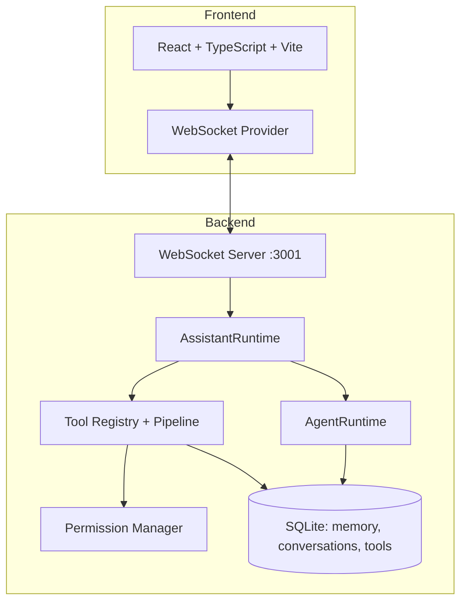

# ORION

[](https://nodejs.org/)
[](https://www.typescriptlang.org/)
[](#testing)
[](LICENSE)

**ORION** is a local-first AI desktop assistant with a React/TypeScript frontend and Node.js backend. It features an **Assistant Layer** for intent classification and task routing, an **Agent Runtime** for autonomous multi-step execution, a **permission-gated tool system** for filesystem/terminal/browser operations, and **persistent memory** backed by SQLite.

> **Status**: Active development. Core chat, agent execution, tool permissions, and memory are verified by automated tests. Assistant conversational responses are template-based; only Agent Runtime and Plan Generation use real LLM calls.

---

## Architecture Overview



### Data Flow (Chat Message)

1. **React** sends `{ type: 'chat', content }` via WebSocket
2. **Server** routes to `AssistantRuntime.processMessage()`
3. **Assistant** classifies intent (keyword heuristic) → determines action
4. **Action executed**:
   - `CHAT_RESPONSE` / `QUESTION` → template response
   - `FILE_OPERATION` → `ToolExecutionPipeline` → permission check → tool
   - `AGENT_TASK` → `AgentRuntime.start()` → multi-step LLM + tool loop
5. **Response** sent back via WebSocket → React updates UI

---

## Verified Features

| Feature | Verified By | Notes |
|---------|-------------|-------|
| WebSocket chat (request/response) | Integration test + manual | Real-time streaming chunks |
| Assistant intent classification | Manual + unit | Keyword heuristic (CHAT, QUESTION, FILE_OPERATION, AGENT_TASK, etc.) |
| Agent multi-step execution | Unit tests (5) + manual | Real LLM calls, tool use, step loop |
| Filesystem tools (list/read/write/delete/move/search) | Unit tests (2) + manual | Path policy enforcement |
| Terminal tool (command execution) | Manual | Requires confirmation |
| Browser tool (search/open) | Manual | Requires confirmation |
| Permission gating (REQUIRES_CONFIRMATION) | Unit tests (2) + manual | WebSocket → UI ConfirmDialog |
| Memory (short-term + long-term SQLite) | Unit tests (path-policy) + manual | Persistent across restarts |
| Model routing (OpenAI-compatible) | Manual | Real calls for agent/plan; heuristic for chat |

---

## Quick Start

### Prerequisites
- **Node.js 20+**
- **npm 10+**
- **LLM API key** (OpenAI-compatible: OpenAI, Ollama, LM Studio, etc.)

### Installation

```bash
# Clone and enter
git clone https://github.com/sarveshaug21-cyber/ORION.git
cd ORION

# Install dependencies
npm install

# Configure environment
cp .env.example .env
# Edit .env with your LLM_API_KEY, LLM_BASE_URL, LLM_MODEL

# Run development (both frontend + backend)
npm run dev
```

- **Frontend**: http://localhost:3000 (Vite + React, HMR)
- **Backend**: http://localhost:3001 (WebSocket at `/ws`, health at `/health`)

### Build for Production

```bash
npm run build          # Builds client (dist/client) + server (dist/server)
npm run start          # Runs production server from dist/server/index.js
```

### Test

```bash
npm test               # 12 unit/integration tests (vitest)
npm run typecheck      # TypeScript check (client config)
npm run lint           # ESLint
```

---

## Environment Variables

| Variable | Required | Default | Description |
|----------|----------|---------|-------------|
| `LLM_API_KEY` | **Yes** | — | API key for OpenAI-compatible provider |
| `LLM_BASE_URL` | No | `https://api.openai.com/v1` | Base URL for LLM API |
| `LLM_MODEL` | No | `gpt-4o-mini` | Model identifier |
| `PORT` | No | `3001` | Backend HTTP/WebSocket port |

> **Security**: Never commit `.env`. The `.gitignore` excludes it. For packaged apps, use system keychain.

---

## Project Structure

```
ORION/
├── .github/workflows/       # CI/CD (to be added)
├── data/                    # SQLite database (gitignored)
├── dist/                    # Build output (gitignored)
├── public/                  # Static assets
├── src/
│   ├── agent/               # AgentRuntime, planner, step-runner, token-budget
│   ├── ai/                  # Model router, providers (OpenAI-compatible), streaming
│   ├── assistant/           # AssistantRuntime, planner, tools, memory, agent-control, response
│   ├── components/          # React UI (MessageList, Sidebar, CommandInput, etc.)
│   ├── database/            # SQLite client, schema, migrations
│   ├── features/            # Memory store implementation
│   ├── hooks/               # Custom React hooks
│   ├── lib/                 # Utilities (id generation, event emitter, etc.)
│   ├── server/              # WebSocket server, tool execution, permissions
│   ├── skills/              # Skill system (system, filesystem, browser, terminal)
│   ├── tools/               # Tool definitions (filesystem, terminal, browser, system)
│   ├── types/               # Shared TypeScript types
│   ├── App.tsx              # Main React app shell
│   ├── main.tsx             # React entry point
│   └── index.css            # Tailwind + custom styles
├── .env.example             # Environment template
├── .gitignore
├── LICENSE                  # GPL-3.0-only
├── package.json
├── package-lock.json
├── tsconfig.json            # Client TypeScript config
├── tsconfig.node.json       # Vite config TypeScript
├── tsconfig.server.json     # Server TypeScript config
└── vite.config.ts           # Vite config (dev proxy to :3001)
```

---

## Known Limitations & Roadmap

### Current Limitations (Honest)

1. **Assistant chat responses are template-based** — No LLM-generated conversational replies; only Agent Runtime uses real LLM calls.
2. **Intent classification is keyword-only** — No semantic understanding; "hello" in a file request matches CHAT first.
3. **Obsidian/Task operations are stubs** — Map to filesystem ops; no real Obsidian API or task DB.
4. **Settings not persisted** — Lost on server restart (in-memory only).
5. **Single-user session** — Hardcoded 'default' user; no auth.
6. **No WebSocket origin validation** — Accepts any origin (security hardening needed for production).
6. **Server build has 100+ TS unused-variable warnings** — Cosmetic, non-blocking.

### Roadmap

- [ ] LLM-based intent classification and response generation
- [ ] Settings persistence (file or DB)
- [ ] Multi-user sessions + authentication
- [ ] WebSocket origin validation + CSP
- [ ] Real Obsidian API integration
- [ ] Task database + UI
- [ ] Vector embeddings for memory search
- [ ] Electron packaging + macOS `.pkg` installer
- [ ] CI/CD pipeline (GitHub Actions)

---

## License

**GPL-3.0-only** — See [LICENSE](LICENSE) for full text.

> **Dependency License Note**: All runtime dependencies are MIT, Apache-2.0, BSD, or ISC licensed, which are GPL-compatible. No proprietary or copyleft-incompatible dependencies are bundled.

---

## Contributing

See [CONTRIBUTING.md](CONTRIBUTING.md) (to be added). In brief:
- Fork → branch → PR
- `npm run typecheck && npm test && npm run lint` must pass
- Conventional commits preferred

---

## Security

See [SECURITY.md](SECURITY.md) (to be added). Report vulnerabilities privately via GitHub Security Advisories.

---

## Author

**Sarvesh** — [@sarveshaug21-cyber](https://github.com/sarveshaug21-cyber)